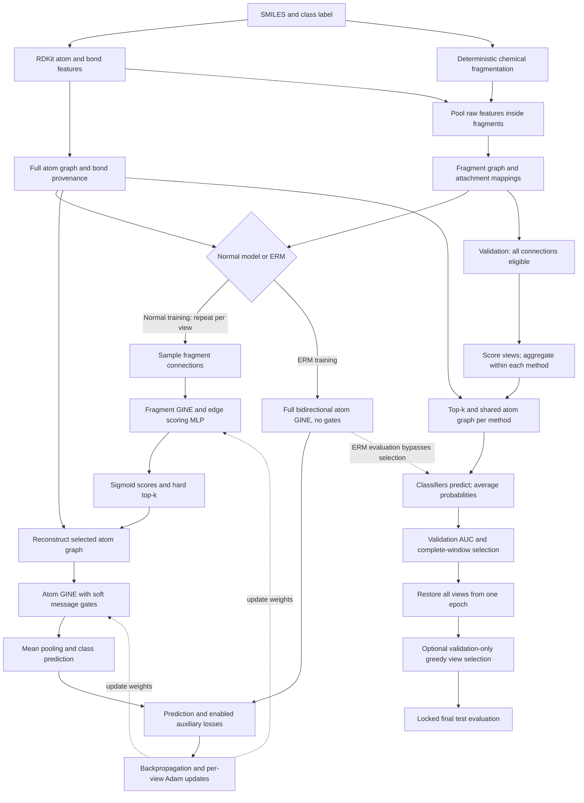
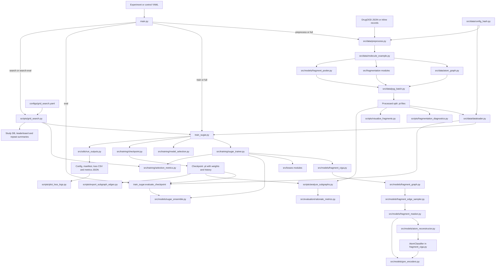

# Fragmentation-Based Invariant Subgraph Extraction

Implementation: `C:/Users/Lance/Documents/GitHub/REU_Summer_2026`, branch `fix/implementation`, commit `4389ca6` plus the September 12 correctness changes. Paths below are relative to that repository, so the guide also works on your server. This describes executable behavior, not an exact reproduction claim for CIGA or SuGAr.

## Dumb It Down

We want a model to learn which parts of a molecule predict its label, and to keep predicting well when test molecules come from a different distribution.

A molecule is a graph: atoms are nodes and bonds are connections. We also construct a smaller graph in which groups of atoms are nodes. That is the fragment graph.

A normal view has two GNNs:

1. A **fragment GNN** examines the fragment graph and scores connections between fragments. It helps choose which structure to retain.
2. An **atom GNN** examines the reconstructed selected structure and predicts the molecule's class.

A **view** is one complete selector-plus-classifier model. Five views means five separate parameter sets with two GNNs each: ten GNN backbones. Views are not individual fragments. They start from shared initial weights but have separate optimizers and sampling streams.

During training each view selects its own structure. During validation and final evaluation, compatible views combine connection scores, classify a shared selected structure, and average class probabilities. This combines evidence both before and after classification.

The ERM control bypasses selection and predicts from the entire atom graph. It executes one GNN per view. Its Python object still contains unused fragment components for structural/checkpoint compatibility; those components are not evidence used by ERM predictions.

## Technical Explanation

**OOD** means out of distribution: the testing population differs from training. **IID** means the same distribution under the dataset's intended split protocol. DrugOOD supplies named splits. The configured task predicts the supplied binary `cls_label`, not raw EC50 values.

**Invariant** is the research objective: select signals that remain useful across environments. Calling a result an invariant subgraph does not prove causal or biological invariance.

**GNN** means graph neural network: nodes repeatedly receive messages from neighbors. An **embedding** is a learned numerical summary. An **MLP** is a stack of fully connected layers. **GINE** is an edge-aware Graph Isomorphism Network: connection features participate in messages, which are summed and transformed.

## Diagram 1: model and learning flow



Validation does not update weights. Test data does not choose the checkpoint. Search now suppresses test/report evaluation. The default full experiment still reports test metrics after training, so use the validation-only controls during development rather than repeatedly choosing changes from test scores.

## 1. Entry points and configuration

- `main.py` routes `preprocess`, `train`, `full`, `resume`, `eval`, `search`, `search-eval`, and diagnostics. `full` combines preprocessing, training and enabled outputs.
- `train_sugar.py` owns seeding, model/trainer construction, checkpoint loading, final split evaluation and optional greedy selection. It expects processed data.
- `configs/experiment.yaml` is the full five-view experiment.
- `configs/erm_baseline.yaml` and `configs/fragment_control.yaml` are matched one-view development controls, differing only in ERM versus fragment selection.
- `configs/grid_search.yaml` defines Optuna choices, repeats, seeds, selection window and repeated evaluation. Despite its filename, this is sampled search, not exhaustive grid enumeration.

Supported explicit CLI arguments override YAML. The new `main.py` options `--seed`, `--sampler-seed` and `--selection-ma-window` make paired server runs and smoke settings explicit.

## 2. Preprocessing: chemistry to reusable tensors

`src/data/preprocess.py` reads native DrugOOD JSON or supported inline/tabular records. Native DrugOOD split names are preserved rather than randomly regenerated. It extracts SMILES, labels, identifiers and metadata, converts each record, then writes one `.pt` payload per selected split. Failure reports record unsuccessful molecules. With `strict: false`, failures can be skipped; inspect counts before comparing experiments.

`src/data/atom_graph.py` creates two related representations:

- `x`, `edge_index`, `edge_attr`: atom message-passing tensors. Each ordinary bond becomes two directed edges so information flows both ways.
- `bond_index`, `bond_attr`: the unique original bond table, used for provenance and reconstruction. Each bond appears once. It is not the full bidirectional GNN input.

That distinction caused the ERM bug fixed in this pass.

Fragmentation is rule-based preprocessing, not a learned GNN:

| Module | Responsibility |
| --- | --- |
| `src/fragmentation/base.py` | Common fragmenter/result structures and validation. |
| `src/fragmentation/__init__.py` | Fragmenter factory. |
| `src/fragmentation/group_graph.py` | Adapts chemical clusters into a partition with original atom/bond mappings. |
| `src/fragmentation/molecule_fragment.py` | Chemical pattern and cluster utilities used by Group Graph. |
| `src/fragmentation/brics.py` | BRICS cuts mapped back to the original molecule. |
| `src/fragmentation/recap.py` | RECAP-style cuts projected onto original atoms. |
| `src/fragmentation/multi_view.py` | Validates method counts and supports multiple fragment representations. |

`src/models/fragment_pooler.py` mean-pools raw atom and internal-bond features within fragments and appends size information. Although under `models`, this active construction does not run an atom GNN before fragment scoring.

`src/data/molecule_example.py` assembles and validates atom/fragment representations and mappings. `src/data/pyg_batch.py` converts them into `MoleculeData` and defines index offsets when batching. These offsets prevent one molecule from accidentally pointing at another molecule's atoms.

| Feature | Width | Meaning |
| --- | --- | --- |
| Atom | 46 | Element, degree, charge, chirality, hydrogen count, hybridization, aromaticity and mass descriptors. |
| Atom bond | 14 | Bond descriptors. |
| Fragment | 62 | 46 pooled atom + 14 pooled internal bond + 2 size features. |
| Fragment connection | 108 | Two attachment-atom blocks, bond descriptors and size information. |

Feature widths are not hidden embedding widths. `hidden_dim: 128` controls the learned GNN representation.

`src/data/config_hash.py` hashes preprocessing-relevant settings. `src/data/dataloader.py` validates saved metadata/hash and constructs seeded PyG loaders. Old 133/149-dimensional caches need regeneration; changing YAML numbers cannot convert tensors. The hash includes the full fragment recipe, so changing view counts can alter compatibility too.

One positive fragmentation method uses unprefixed fragment fields; mixed methods use method-specific fields. Recipe counts must sum to `num_views`, including ERM's reused preprocessing/storage pipeline. The supplied ERM config already contains a valid one-view recipe.

## 3. One view: selector, reconstruction, classifier

`src/models/fragment_ciga.py` composes the path:

1. `fragment_graph.py` obtains the method-specific fragment representation.
2. `fragment_edge_sampler.py` retains a random fixed-size subset of connections per molecule during training. `fragment_sample_ratio` controls this budget; evaluation keeps all connections. Original identifiers preserve alignment.
3. `fragment_masker.py` runs a fragment GINE. It adds reverse edges and reverses endpoint-dependent attributes for encoder message passing. Scores remain aligned with canonical stored connections.
4. An edge MLP combines endpoint embeddings and connection features. Sigmoid maps scores between zero and one.
5. Hard top-k selects the highest-scoring eligible connections. The target is `max(1, floor(full_connection_count * edge_ratio))`, capped by eligible count. Zero-connection graphs have special reconstruction handling; `edge_ratio: 0` is not a general empty-graph switch.
6. `atom_reconstructor.py` maps retained connections to atoms/bonds and internal structure of retained fragments. Inter-fragment bonds receive their connection score; internal bonds use incident-score-derived fragment importance. Fast and analysis paths share weighting logic.
7. `AtomClassifier` runs atom GINE with scores as message gates, mean-pools atom embeddings and applies an MLP prediction head. Outputs are stable log-probabilities.

**How does the selector learn through discrete top-k?** Membership selection is detached from gradients, but selected continuous scores still multiply atom messages. Prediction loss therefore reaches the scorer through those scores. This does not differentiate through the sorting decision itself.

GINE's self contribution is ungated. A gate does not uniformly scale the entire model output, and its score is not automatically a causal importance probability.

`src/models/gnn_encoders.py` provides GIN/GINE and retains GAT code. GAT is not the active configured classifier. GINE uses BatchNorm, ReLU and training-time dropout. Full fragment-edge retention is not guaranteed equivalent to ERM: soft gates remain and disconnected-component reconstruction needs explicit verification.

## 4. Training, losses and environments

`src/training/sugar_trainer.py` holds views and one Adam optimizer per view. It computes per-view predictions and combined losses, backpropagates, clips each view's gradient norm to 1, and updates weights.

| File | Objective |
| --- | --- |
| `src/losses/prediction.py` | Negative log likelihood: increase probability of the correct class. Per-view losses are summed. |
| `src/losses/supervised_contrastive.py` | Arrange graph embeddings so same-class examples are close relative to others. Uses concatenated view embeddings; `mul` is the configured mode. |
| `src/losses/diversity.py` | Penalize positive similarity between centered score patterns of compatible views, using jointly eligible edges. Average across pairs/molecules and compatible method groups. |
| `src/losses/irm.py` | Penalize squared gradients of environment losses with respect to a dummy prediction scale. At least two environments must be present in the actual batch. Environment penalties and per-view penalties are summed. |

Total loss is prediction plus enabled auxiliary losses multiplied by their lambda coefficients. Coefficients are not comparable percentages: the losses have different scales and reductions.

The main config has contrast OFF (`0`), diversity ON (`0.5`) and IRM ON (`2`, two environments). Both control configs set all three coefficients to zero. The ERM flag bypasses the selector; use zero auxiliary coefficients for a pure ERM experiment.

For environments, the trainer reads `env_split_key` from metadata, falling back to the stored group value. Domain values are ordered by value, or by per-domain mean atom count for `size`, then divided into buckets. Buckets balance domain counts, not necessarily molecule counts or class proportions. Assignment is computed separately for each loader and attached before shuffling. Missing metadata can cause a warned random fallback. Size grouping does not guarantee balanced labels.

Training accuracy averages independent view predictions. Validation AUC uses shared-subgraph ensemble inference. Validation loss components describe per-view objectives; they are not precisely the same calculation as ensemble AUC.

## 5. Ensemble and model selection

`src/models/sugar_ensemble.py` groups compatible views by fragmentation method, aggregates connection scores by `mean` or `max`, selects one shared structure per method, runs each group's classifiers, and averages all class probabilities. It cannot directly average BRICS and Group Graph edge scores because their edges differ.

Soft voting computes log mean probability with `logsumexp`. It does not average class labels or simply average logits. Evaluation disables dropout and random edge removal, uses BatchNorm's stored statistics and performs no optimizer step.

`src/training/selection_metrics.py` supplies complete finite-window averaging to both trainer and search. For a five-epoch window:

- Epochs 1–4 are warm-up: no checkpoint selected and no patience spent.
- Epoch 5 produces the first complete average.
- Improvement stores all views together and resets patience.
- Eligible non-improvements consume patience; the best joint checkpoint is restored at the end. Ties retain the earlier winner.
- A budget shorter than the window fails early. Missing/nonfinite windows cannot win.
- A switch between AUC and accuracy fallback starts a new window instead of mixing metric units.

CSV/history now include `val_selection_metric_smoothed` alongside the raw metric. History includes `selected_checkpoint_epoch` and `best_selection_metric_smoothed`; final metrics include selection settings. A checkpoint's top-level `epoch` remains total completed training epochs, which can differ from the restored epoch in history.

Top-K snapshot retention now includes runners-up, not only record breakers. **Weight averaging is rejected for BatchNorm models until normalization recalibration is implemented. Keep `selection_weight_avg: false`.** Averaging weights, averaging predictions and averaging AUC numbers are different procedures.

`src/training/model_selection.py` optionally selects a view subset greedily on validation AUC, with accuracy fallback. `train_sugar.py` reports full-ensemble metrics and separately reports greedy-selected test metrics when enabled. Later checkpoint evaluation uses all views unless `--use-selected-views` is supplied. Decide the primary result before testing. Controls disable greedy selection.

`src/training/checkpoint.py` saves weights, dimensions, config, history, metrics, selected views and optimizer state. `main.py eval` rebuilds and reloads models. The smoke test verifies evaluation parity before and after reload.

**Resume limitation:** selection restores earlier model weights but does not rewind optimizer moments to the same earlier epoch. History and selection are not an exact interrupted-run replay either. Treat `resume` as continued training, not bit-identical continuation. This pass did not redesign resumption.

## 6. Search versus final evaluation

`scripts/grid_search.py search` samples Optuna combinations and calls normal training for each repeat. Its objective is the best complete-window validation AUC averaged across repeats. `auc_ma_window` also sets the trainer window; conflicting fixed overrides and independently tuning that window through the grid are rejected.

Search now forces `test_split: null`, `report_splits: []` and `log_test_curve: false` for each effective run, even if another setting requests test metrics. This suppresses evaluation, not necessarily loading all processed splits named in the storage config. These temporary exclusions do not become the final-evaluation override policy.

`scripts/grid_search.py eval` retrains chosen settings over evaluation seeds and reports configured test results. Search window-average AUC and a restored checkpoint's final AUC are not numerically interchangeable. The search objective still uses full-ensemble history, not post-greedy scores; controls disable greedy selection to remove that extra choice.

Use a fresh study/output namespace after source or protocol changes. Existing studies are not automatically comparable. Review printed CLI/spec override conflicts and preserve effective configs. A real Optuna study was not run during local verification.

## Diagram 2: file and artifact flow



Arrows show major dependencies/data flow, not every import or exact call order. Both GNNs use `gnn_encoders.py`; reconstruction does not create a third GNN.

## 7. Diagnostics and output files

Consolidated outputs use `outputs/{dataset}/{fragmentation_recipe}/{run_name}/`. `src/utils/run_outputs.py` resolves paths and writes effective configuration and manifests. Use unique run names and preserve the source revision/patch; a commit hash does not identify uncommitted edits.

- `scripts/fragmentation_diagnostics.py`: preprocessed fragment/connection statistics.
- `scripts/visualize_fragments.py` and its runner: deterministic fragmentation pictures before learning.
- `scripts/plot_loss_logs.py`: plots loss CSVs.
- `scripts/analyze_subgraphs.py`: selected structure analysis, support-filtered fragment/pair frequencies, label-conditioned descriptive tables and molecule figures.
- `scripts/export_subgraph_edges.py`: selected-structure edge export.
- `scripts/inspect_processed_pt.py`: individual stored records.
- `src/evaluation/rationale_metrics.py`: retention and atom-set overlap/Jaccard summaries.

These are descriptive explanations, not proof of biological causality. ERM rationale analysis is skipped by `full`; direct extraction fails clearly rather than displaying its unused random selector.

`src/evaluation/metrics.py`, `src/evaluation/ood_splits.py`, `src/models/optional_atom_encoder.py` and `src/models/weight_average.py` are empty placeholders. Real AUC evaluation is in trainer/training/model-selection code; native split handling is in preprocessing. A filename does not mean a feature is implemented.

## 8. Main settings and controls

| Setting | Main experiment | Both controls |
| --- | --- | --- |
| Views / method | 5 / Group Graph | 1 / Group Graph |
| Hidden width / layers | 128 / 3 | Same |
| Batch size / dropout | 64 / 0.3 | Same |
| Learning rate / weight decay | 0.001 / 0.0001 | Same |
| Edge retention / sampling | 0.3 / 0.9 | Same settings; bypassed in ERM |
| Contrast / diversity / IRM | 0 / 0.5 / 2 | 0 / 0 / 0 |
| Environments | 2, domain-value buckets | 1, IRM disabled |
| Epoch cap / patience / window | 100 / 20 / 5 | Same |
| Weight averaging / test curve | Off / off | Off / off |
| Greedy selection | On | Off |
| Development reporting | Includes test/report splits | OOD validation only |

The partner's IRM mean-to-sum change remains. Account for view count and reduction before reusing an old lambda interpretation. These defaults are experiment choices, not proven optimal values.

## 9. Changes and local verification

September fixes: bidirectional ERM input; complete-window checkpoint policy shared with search; smoothed-score logging; correct top-K retention; BatchNorm averaging guard; ERM rationale guard; search test suppression; CLI seed/window controls; matched development YAMLs; edge-associated reconstruction tests; reusable smoke script.

No architecture replacement or retuning was performed. Useful partner fixes for numerical stability, fragment message direction and reconstruction were retained. No full DrugOOD benchmark ran locally.

Verification: 104 unit tests passed (92 existing plus 12 new), including deterministic graph/checkpoint tests and synthetic CPU runs for ERM, two-view Group Graph and mixed Group Graph/BRICS. Each smoke case preprocesses temporary molecules, trains two epochs, evaluates, saves/reloads and checks metric parity within 1e-6. Temporary outputs are removed afterward. Artificial labels cannot establish OOD quality. CUDA and real Optuna execution remain server checks.

## 10. Server handoff: your next steps

Commands assume a Linux shell at repository root with a project-local Python environment activated. On Windows use the corresponding virtual-environment executable. Do not copy the Windows `.venv` onto Linux.

### A. Transfer all changes and verify the environment

Changes remain local/uncommitted until reviewed and committed. Server `git pull` alone cannot obtain them yet. Transfer the working tree through your normal method, or commit and push when you choose to authorize publication. Record revision plus patch for every run.

Use an existing compatible server environment first:

```bash
python -c "import torch, torch_geometric, rdkit; print(torch.__version__, torch_geometric.__version__, rdkit.__version__); print('CUDA:', torch.cuda.is_available())"
python -m unittest discover -s tests -q
python scripts/smoke_test.py --device cuda
```

If CUDA smoke fails, retain the traceback and versions. Do not start a large search. Extension/runtime incompatibility is not an ML performance result.

### B. Prepare a separate validation-only control cache

Place raw DrugOOD JSON at the configured `raw_path`, or edit both control configs consistently. Their cache is under `data/processed/controls_v1/...`, separate from the main cache. Changing the raw-path string changes the config hash.

```bash
python main.py preprocess --config configs/erm_baseline.yaml --validate-loaders
```

This prepares only `train` and `ood_val`. Check failures, split counts, labels and dimensions. Both controls have identical preprocessing settings, so one pass serves both. Do not bypass metadata failures to reuse an incompatible cache.

### C. One real-data epoch per model

```bash
python main.py train --config configs/erm_baseline.yaml --device cuda --epochs 1 --selection-ma-window 1 --seed 11 --sampler-seed 11 --run-name erm_preflight_s11
python main.py train --config configs/fragment_control.yaml --device cuda --epochs 1 --selection-ma-window 1 --seed 11 --sampler-seed 11 --run-name fragment_preflight_s11
```

These are full real-data epochs, not tiny synthetic batches. Check memory, runtime and finite losses; do not choose a scientific winner from these preflight scores. Window 1 is specifically for the short preflight.

### D. Matched validation-only comparisons

After preflight passes, use the normal window and the same seed set:

```bash
for seed in 11 22 33; do
  python main.py train --config configs/erm_baseline.yaml --device cuda --seed "$seed" --sampler-seed "$seed" --run-name "erm_control_s${seed}"
  python main.py train --config configs/fragment_control.yaml --device cuda --seed "$seed" --sampler-seed "$seed" --run-name "fragment_control_s${seed}"
done
```

This is six runs capped at 100 epochs with patience 20. Same seeds improve comparability but do not make architectures perform identical calculations. Three seeds are an initial diagnostic, not a strong statistical guarantee.

Preserve effective configs, manifests, complete loss CSVs, validation metrics and checkpoints. Also keep package versions, GPU model, source revision/patch and preprocessing failure counts. Stop on nonfinite loss, dimension mismatch, empty splits or missing validation.

### E. Send evidence back

Send the six run folders, or at least config/manifest/loss/metrics files and preprocessing summary. Checkpoints enable follow-up prediction comparisons but are larger. State any server-side config edits. Do not send only the best seed.

## 11. What the assistant does after server results

1. Verify source/config/data provenance and validation-only operation.
2. Compare paired validation differences, curves, selected epochs, loss components and variability. Avoid a universal arbitrary AUC-gap threshold.
3. If ERM learns but selection hurts, isolate topology retention and soft gates while holding other settings fixed. Verify full-retention topology, including disconnected components.
4. Test additional views without penalties, then diversity, contrastive learning and IRM individually. Check environment labels and batch coverage before interpreting IRM.
5. Prepare a narrow Optuna search only once these comparisons make sense, using a fresh study namespace.
6. Lock architecture, hyperparameters, checkpoint rule and primary ensemble result before final testing. Prepare separate final configs/caches including test splits where storage hashes change.
7. Evaluate predeclared additional seeds and report variability. Historical reproduction is separate: `aa2d1f5` is a parent reference, not verified evidence of historical good performance.

No server connection was configured in this task. You execute on the server and return evidence; the assistant can then analyze it and prepare the next smallest experiment.

## Quick understanding check

- Why are there two directed message edges for one chemical bond?
- Which GNN selects structure, and which predicts the class?
- Why can gradients reach a scorer despite discrete top-k membership?
- Why do window-average validation AUC and final test AUC differ?

Answers: both atoms need neighbor information; fragment GNN versus atom GNN; continuous selected gates retain a gradient path; the metrics summarize different data and/or model states under different selection rules.


## Fixed-budget selection follow-up

The new `compare_selection_policies` mode disables early stopping and saves best-raw and best-complete-window-endpoint checkpoints from the same trajectory. See `docs/SELECTION_COMPARISON.md` in the repository for commands and interpretation limits. Run `python scripts/smoke_test.py --device cuda --compare-selection` before `bash scripts/run_selection_comparison.sh`. The comparison uses validation only, reuses the control preprocessing cache, and writes to `outputs_policy_comparison`. The suite now contains 108 tests.


## Policy decision — September 13, 2026

The primary policy is now best individual validation AUC (selection_ma_window: 1). New development configs use early_stopping: false for a fixed 100-epoch budget. Historical MA5 comparison configs and results remain unchanged. See [[REU_Next_Experiments_Best_AUC]] for the staged five-view and auxiliary-loss script. This update supersedes the earlier main-setting window/patience description for new default runs.
